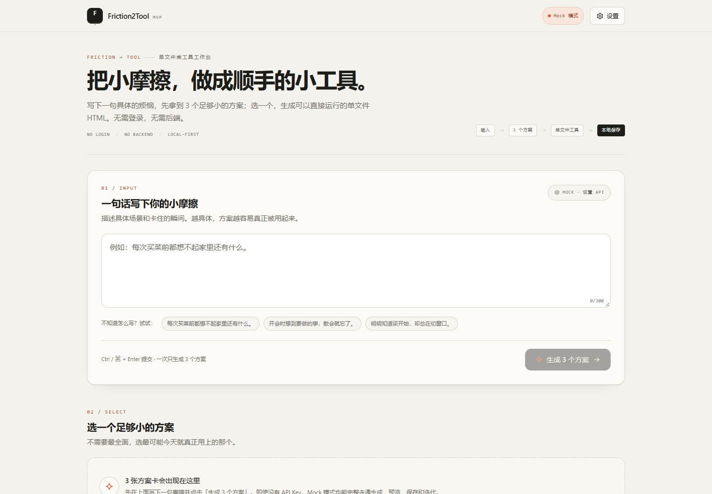
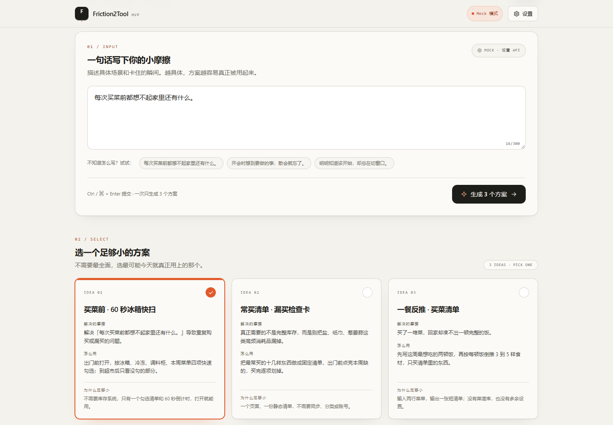
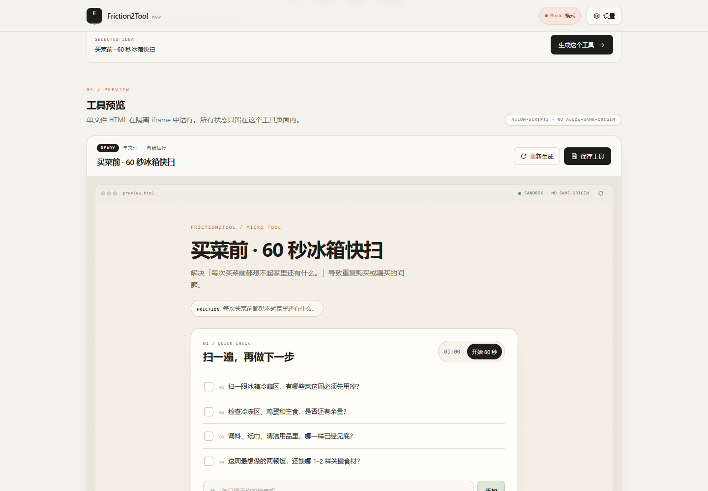
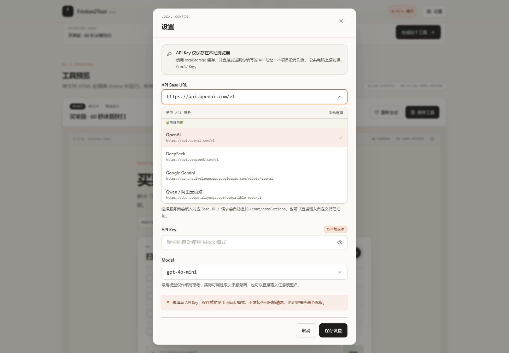
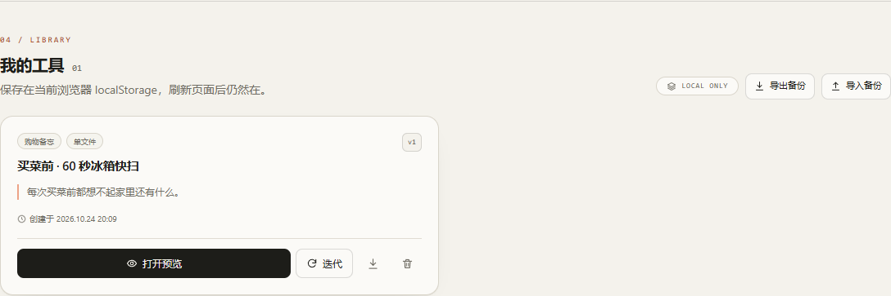

# Friction2Tool

> Turn one everyday friction into three tiny tool ideas and a runnable single-file HTML tool.

把一句日常「小摩擦」，变成 3 个微型工具方案；选一个后生成可直接运行的单文件 HTML 小工具，在页面内预览、保存，并基于反馈继续迭代。

这是一个前端-only 的 MVP：**无登录、无后端、无数据库**。所有工具保存在浏览器 `localStorage`。

<p>
  <a href="https://lzx6133-cloud-all.github.io/friction2tool/"><strong>Live Demo</strong></a> ·
  <a href="#功能">功能</a> ·
  <a href="#快速开始">快速开始</a> ·
  <a href="#测试">测试</a> ·
  <a href="#部署到-github-pages">部署</a> ·
  <a href="#license">License</a>
</p>

[](LICENSE)
[](https://github.com/lzx6133-cloud-all/friction2tool/actions/workflows/ci.yml)

> **Live Demo:** the Pages link becomes available after the first deployment of this repository.
>
> **Status: experimental, local-first MVP.** Not production-ready. API Keys are stored
> unencrypted in the visitor's browser, and browser-direct API calls require provider CORS.

<details>
<summary><strong>English summary</strong></summary>

Friction2Tool is a local-first AI micro-tool generator built with React, Vite and
TypeScript. Describe one everyday friction, get three deliberately small tool ideas,
then generate a complete single-file HTML tool that runs inside a sandboxed iframe.

- Works out of the box in Mock mode, without an API key.
- Supports OpenAI-compatible Chat Completions APIs configured in the browser.
- Saves tools and simple version history in `localStorage`.
- Injects a no-network CSP and never grants `allow-same-origin` to generated tools.
- No backend, accounts, database or server-side secrets.

```bash
npm install
npm run dev
```

See the Chinese sections below for configuration, deployment, testing and security details.

</details>

## 界面预览

| 首页 / 输入摩擦 | 3 个微工具方案 |
| --- | --- |
|  |  |
| **单文件工具预览** | **服务商与模型设置** |
|  |  |

## 功能

- 输入一句具体摩擦，一次生成 3 个方案卡片，包含：工具名、解决的摩擦、怎么用、为什么足够小。
- 选中方案后生成完整单文件 HTML，内联 CSS / JS，无外部依赖。
- 工具的 iframe 预览带沙箱隔离，不授予 `allow-same-origin`。
- 保存到本地工具库；刷新后仍在。
- 打开预览、删除、基于反馈生成新版本，并保留简单版本历史。
- 支持导出单个 HTML 工具，以及导出/导入全部工具的 JSON 备份（不包含 API Key）。
- OpenAI-compatible Chat Completions API；设置面板可配置 Base URL、API Key、Model。
- API Base URL 支持滚动选择常用服务商；带有强特征前缀的 Key 会自动匹配 Base URL。
- Model 支持按服务商滚动选择常用模型，也保留手动输入任意模型名。
- 服务商与模型不匹配时，会显示推荐模型并支持一键填入。
- 设置内提供「测试连接」，会发送一次最小请求验证 URL、CORS、鉴权和模型名。
- **没有 API Key 时自动使用 Mock 模式**，完整走通整个流程。

## 快速开始

要求 Node.js 20+。

```bash
cd friction2tool
npm install
npm run dev
```

打开终端显示的本地地址（默认 `http://127.0.0.1:5173`）。

> Windows 上建议直接使用 `127.0.0.1`，不要用 `localhost`。部分浏览器（例如 Edge）会优先解析到 IPv6 `::1`，而 Vite 默认可能只绑定 IPv6，导致浏览器打不开页面。本项目已在 `vite.config.ts` 中固定绑定 IPv4 回环地址 `127.0.0.1`。

如果设置弹窗因浏览器缓存或扩展而无法点击，可以直接打开带参数的 URL，设置会在页面载入后自动打开：

```text
http://127.0.0.1:5173/?settings=1
```

生产构建：

```bash
npm run build
npm run preview
```

类型检查：

```bash
npm run typecheck
```

## 测试

项目包含两类自动化测试：

- **Vitest 单元测试**：JSON / HTML 提取、CSP 注入、服务商 Key 识别、reasoning 模型请求参数、参数失败重试、备份导入合并。
- **Playwright 端到端测试**：Mock 模式完整闭环、设置中的服务商 / Key 识别、弹窗焦点陷阱、备份导入导出、移动端布局。

```bash
npm run test:unit
npx playwright install chromium
npm run test:e2e
```

如果本机已安装 Edge，也可以跳过浏览器下载：

```powershell
$env:PLAYWRIGHT_CHANNEL = "msedge"
npm run test:e2e
```

`playwright.config.ts` 会在本地自动复用已运行的 dev server，在 CI 中自行启动。
GitHub Actions 会在构建和部署前运行单元测试和端到端测试。

## 部署到 GitHub Pages

项目使用纯静态产物，不需要后端。已经准备好：

- [.github/workflows/ci.yml](.github/workflows/ci.yml)：类型检查、构建、单元测试和 Playwright 测试
- [.github/workflows/deploy-pages.yml](.github/workflows/deploy-pages.yml)：全部测试通过后部署 `dist/`
- `vite.config.ts` 在生产构建中使用相对资源路径，兼容 GitHub Pages 的子路径

发布步骤：

1. 在 GitHub 创建公开仓库（建议名称 `friction2tool`）。
2. 推送 `main` 分支。
3. 打开仓库 **Settings → Pages → Build and deployment → Source**，选择 **GitHub Actions**。
4. 手动运行一次 **Deploy to GitHub Pages** workflow，或向 `main` 推送一次。
5. 部署地址通常是 `https://<你的用户名>.github.io/friction2tool/`。
6. 首次部署完成后确认顶部 Live Demo 地址可访问。
7. 在 **Settings → General → Social preview** 上传 [docs/social-preview.png](docs/social-preview.png)。

完整的仓库创建、GitHub 设置、Release 和推送步骤见 [docs/PUBLISHING.md](docs/PUBLISHING.md)。

Demo 默认使用 Mock 模式，访问者不需要 API Key。API 模式仍可由访问者自行配置，
Key 只保存在访问者自己的浏览器中，不会进入你的仓库或构建产物。

> 公开 Demo 部署在 HTTPS 环境，访问者浏览器中的本地 Ollama（HTTP localhost）通常会被
> 混合内容限制拦截。Mock 模式不受影响。

## 两种模式

### Mock 模式（默认）

API Key 留空即进入 Mock 模式。不会发起网络请求：

- 根据摩擦中的关键词（购物、备忘、拖延等）生成 3 个不同的演示方案。
- 生成的 HTML 是一个真实可交互的小工具，包含清单、添加项、进度和 60 秒计时器。
- 可以正常预览、保存、刷新、删除和迭代。

### API 模式

点击右上角「设置」填写：

| 配置 | 说明 |
| --- | --- |
| API Base URL | OpenAI-compatible 服务的基地址；可从内置服务商列表滚动选择，也可手动输入自定义代理地址 |
| API Key | 浏览器直接使用，只保存在本地 `localStorage` |
| Model | 服务端支持的模型名；可从内置常用模型列表滚动选择，也可手动输入 |

### Base URL 快捷选择与 Key 识别

Base URL 下拉内置：OpenAI、DeepSeek、Google Gemini、Qwen / 阿里云百炼、Moonshot / Kimi、智谱 GLM、SiliconFlow、Groq、Mistral、xAI、OpenRouter、Ollama / 本地。

Key 前缀识别规则：

| Key 前缀 | 自动匹配的 Base URL |
| --- | --- |
| `sk-or-v1-` | OpenRouter |
| `gsk_` | Groq |
| `xai-` | xAI |
| `AIza` | Google Gemini |
| `sk-proj-` / `sk-svcacct-` | OpenAI |

普通 `sk-` 无法唯一判断服务商（OpenAI、DeepSeek、Kimi 等都可能使用），因此不会强行覆盖 Base URL，而是提示手动选择。已经手填的自定义 Base URL/代理地址也不会被自动识别覆盖。

自动识别只发生在浏览器本地：不会额外上传或验证 Key。选择服务商后，如果 Model 与对应服务商不匹配，设置中会显示推荐模型，可一键填入。

设置底部的「测试连接」会使用当前草稿配置发送一次最小请求（不保存设置），方便先验证 Base URL、CORS、鉴权和模型名，再开始生成。

请求参数会兼容不同模型：对 GPT-5、o 系列和 `reasoner` 模型不发送 `temperature` / `max_tokens`；普通模型遇到参数相关的 400/422 时会自动用最小兼容参数重试一次。

保存后 Header 会显示「API 模式」。实际请求发往：

```text
{API Base URL}/chat/completions
```

如果 Base URL 本身已经以 `/chat/completions` 结尾，则不会重复拼接。

常见配置示例：

```text
OpenAI
Base URL: https://api.openai.com/v1
Model:    gpt-4o-mini

DeepSeek
Base URL: https://api.deepseek.com/v1
Model:    deepseek-chat

Ollama（本地）
Base URL: http://localhost:11434/v1
Model:    qwen2.5:7b
API Key:  随便填一个非空值，例如 ollama
```

> Ollama 等本地服务通常不校验 Key，但本项目会把空 Key 视为 Mock 模式，因此需要一个非空占位值。

## 浏览器直连与 CORS

本项目按需求从浏览器直接 `fetch` API，没有代理层。因此：

- API 服务必须允许浏览器跨域，并允许 `Authorization` 请求头；否则会出现 CORS 错误。
- OpenAI-compatible 服务如果只支持服务端调用，就需要自建一个受信任的代理，再把 Base URL 指到代理地址。
- 报错信息会区分鉴权失败、404、429、5xx、超时、CORS 等常见情况。
- API 失败时会保留用户输入，并显示可重试的错误提示。

## API Key 与安全说明

- API Key 只保存在当前浏览器 `localStorage` 的 `friction2tool.settings.v1` 中。
- 请求时 Key 直接发送到你填写的 API Base URL；项目本身不收集、不转发到其他服务。
- 本项目**没有加密 Key**。请勿在公共或共享电脑上保存真实 Key。
- 生成的工具在 `sandbox="allow-scripts allow-forms allow-modals"` 的 iframe 中运行，不含 `allow-same-origin`，无法读取父页面 DOM、localStorage 或 cookie。
- 前端还会给生成的 HTML 注入严格 CSP：

  ```text
  default-src 'none'; script-src 'unsafe-inline'; style-src 'unsafe-inline';
  img-src data: blob:; font-src data:; connect-src 'none';
  form-action 'none'; base-uri 'none'; navigate-to 'none';
  ```

  即使模型生成了网络请求代码，也会被 CSP 拦截。CSP 还声明了 `navigate-to 'none'`，
  但浏览器支持并不一致。

  仍然存在无法由父页面完全消除的残余风险：生成代码可能让 iframe 自行导航，
  或通过死循环消耗 CPU。预览刷新按钮可以重建 iframe；不要把生成结果当作绝对安全的代码执行环境。
- 工具支持 JSON 备份/导入，但备份只包含工具数据，不包含 API Key。localStorage 被清空时仍可能丢失数据，建议定期导出。

## 工具备份与导出

- 工具卡片上的下载按钮会导出当前版本的单文件 `.html`。
- 「导出备份」会下载包含全部工具和版本的 JSON；「导入备份」按 `id` 合并，较旧的同 ID 记录不会覆盖较新版本。
- 备份文件不包含 API Key。导入文件限制为 8 MB。



## LLM 调用与输出处理

### 第一次调用：生成方案

系统提示要求模型只返回严格 JSON：

```json
{
  "ideas": [
    {
      "title": "工具名",
      "problem": "解决什么问题",
      "howItWorks": "怎么用",
      "whySmall": "为什么足够小"
    }
  ]
}
```

前端会：

1. 按 `choices[0].message.content` 读取文本。
2. 自动剥离 Markdown code fence。
3. 尝试直接 `JSON.parse`；失败时提取第一个完整的 JSON 对象。
4. 清除对象中的尾逗号后重试一次。
5. 校验字段完整性和数量；必须是 3 个完整方案，否则提示重试。

### 第二次调用：生成单文件工具

要求模型返回从 `<!doctype html>` 到 `</html>` 的完整文档，并满足：

- 所有 CSS / JS 内联。
- 无 CDN、外部字体、外部图片、网络请求。
- 不使用 `localStorage` / `sessionStorage` / cookie；状态只在内存。
- 移动端可用。

返回后前端会：

- 剥离 Markdown 围栏和前后解释文字。
- 拒绝不完整 HTML 片段，提示重新生成。
- 移除此前的 CSP，并注入项目自己的无网络 CSP。
- 确保存在 viewport meta。

## 数据模型与 storage keys

```ts
interface SavedTool {
  id: string;
  title: string;
  friction: string;
  idea: { title; problem; howItWorks; whySmall };
  html: string;
  tags: string[];
  createdAt: number;
  updatedAt: number;
  versions: { html: string; feedback: string; createdAt: number }[];
}
```

- `friction2tool.tools.v1`：保存的工具列表。
- `friction2tool.settings.v1`：API Base URL、API Key、Model。
- `SavedTool.html` 始终是当前最新版本。
- `versions` 保存被替换的旧快照。每条记录的 `feedback` 是触发下一版生成的反馈。
- 版本 UI 只展示版本时间与反馈，不提供复杂的分支、回滚或合并。

保存失败（包括 localStorage 配额已满）会显示明确提示，不会静默丢失状态。

## 项目结构

```text
friction2tool/
├── .github/
│   ├── dependabot.yml
│   └── workflows/
│       ├── ci.yml               # build + unit + Playwright tests
│       └── deploy-pages.yml     # test + deploy dist to GitHub Pages
├── docs/                        # screenshots, social preview, publishing guide
├── tests/
│   ├── smoke.spec.ts            # E2E: full flow, modal focus, backup, mobile
│   └── unit/
│       ├── backup.test.ts
│       ├── html.test.ts
│       ├── llm.test.ts
│       └── models.test.ts
├── index.html
├── src/
│   ├── main.tsx
│   ├── App.tsx                  # 主流程与跨组件状态
│   ├── index.css
│   ├── types.ts
│   ├── constants.ts
│   ├── components/
│   │   ├── Header.tsx
│   │   ├── FrictionComposer.tsx # 摩擦输入与示例
│   │   ├── IdeaCard.tsx
│   │   ├── ToolPreview.tsx
│   │   ├── PreviewFrame.tsx    # sandbox iframe
│   │   ├── MyTools.tsx
│   │   ├── ToolDetailDialog.tsx # 预览 / 反馈迭代 / 版本记录
│   │   ├── SettingsDialog.tsx
│   │   ├── BaseUrlCombobox.tsx # 常用服务商滚动选择
│   │   ├── ModelCombobox.tsx   # 常用模型滚动选择 / 自定义输入
│   │   ├── PresetCombobox.tsx  # 可输入、可滚动、键盘可操作的下拉基础组件
│   │   ├── Modal.tsx
│   │   ├── Toast.tsx
│   │   └── Icons.tsx
│   └── lib/
│       ├── llm.ts              # API 调用、Mock 分流、错误归一化
│       ├── llm-types.ts
│       ├── prompts.ts          # 两次调用的提示词
│       ├── mock.ts             # Mock 方案和可交互 HTML
│       ├── models.ts           # 常用服务商、Base URL、模型与 Key 识别规则
│       ├── backup.ts           # 单工具导出、JSON 备份/导入与合并
│       ├── settingsLink.ts     # 设置入口与 URL 兜底
│       ├── html.ts             # JSON/HTML 提取、校验、CSP 注入
│       ├── storage.ts          # localStorage 与配额错误
│       └── format.ts
├── playwright.config.ts
├── vitest.config.ts
├── tailwind.config.js
├── postcss.config.js
├── vite.config.ts
├── tsconfig*.json
├── LICENSE
├── SECURITY.md
├── .nvmrc
├── .gitattributes
├── .gitignore
└── README.md
```

## 手动验收

Mock 模式：

1. 不配置 API Key，输入「每次买菜前都想不起家里还有什么。」
2. 点击「生成 3 个方案」，应出现 3 张方案卡。
3. 选择一张，点击「生成这个工具」，iframe 中出现可交互工具。
4. 勾选清单项、添加新项、启动计时器。
5. 点击「保存工具」，刷新页面，「我的工具」中仍存在。
6. 打开预览，输入反馈并生成新版本，保存后版本号增加。
7. 删除工具，刷新后不再出现。

API 模式：

1. 在设置中填入支持 CORS 的 OpenAI-compatible 服务。
2. 生成方案；如模型返回 Markdown 围栏，应能自动解析。
3. 生成 HTML；如模型返回不完整文档，应显示错误并允许重试。
4. 保存后检查 localStorage 中的 HTML 已注入 CSP。

## MVP 限制

- 不做登录、后端、数据库、多人协作、权限。
- 没有 API 代理；CORS 由所配置的服务决定。
- 没有复杂版本管理：只保留当前版本 + 旧版本快照。
- 生成质量取决于模型；方案不合意可重新生成，或调整摩擦描述。
- localStorage 容量有限，工具和 API Key 都未加密。
- 这是实验性 local-first MVP，不建议直接作为生产服务或多人共享工具。

安全问题请参阅 [SECURITY.md](SECURITY.md)，不要在公开 Issue 中粘贴 API Key。

## 贡献

欢迎 Issue 和 PR。提交前请运行：

```bash
npm run typecheck
npm run build
npm run test:unit
npm run test:e2e
```

请保持“无后端、local-first、生成工具不联网”的核心约束。

## License

[MIT](LICENSE) © 2026 Friction2Tool contributors
